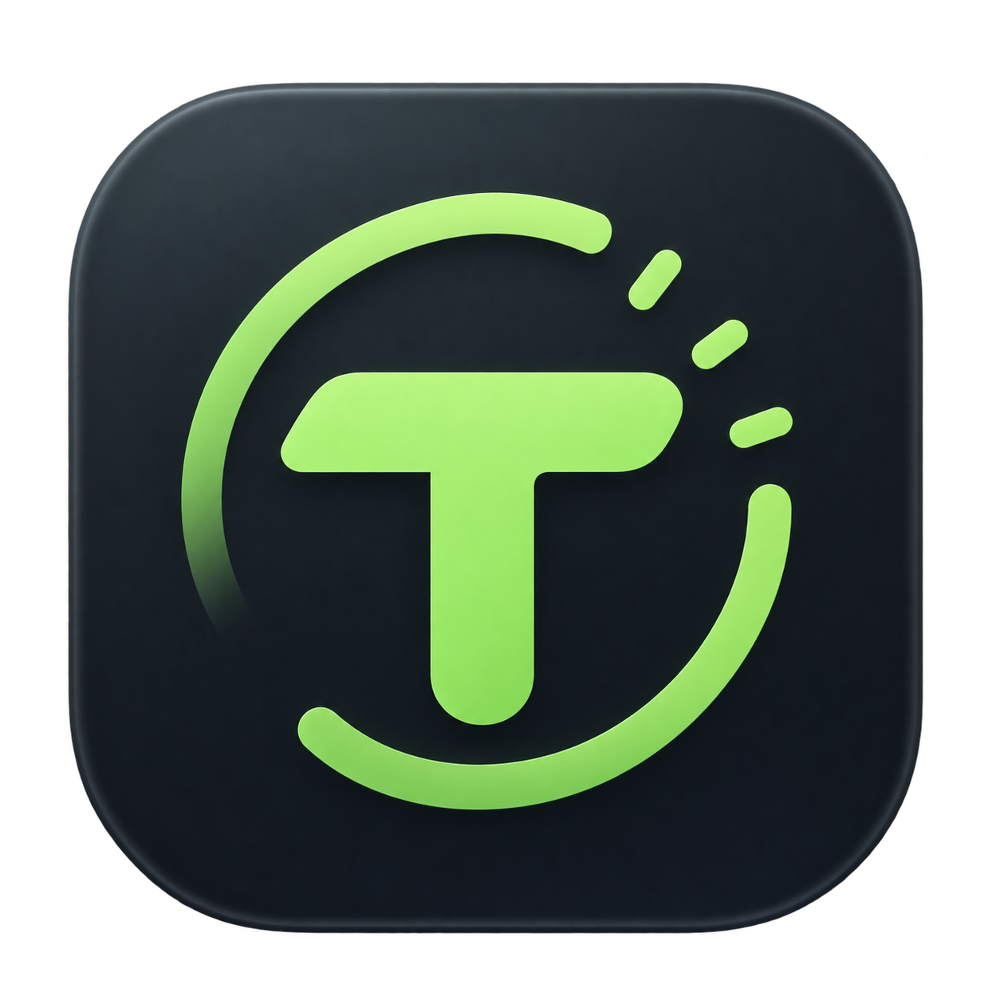
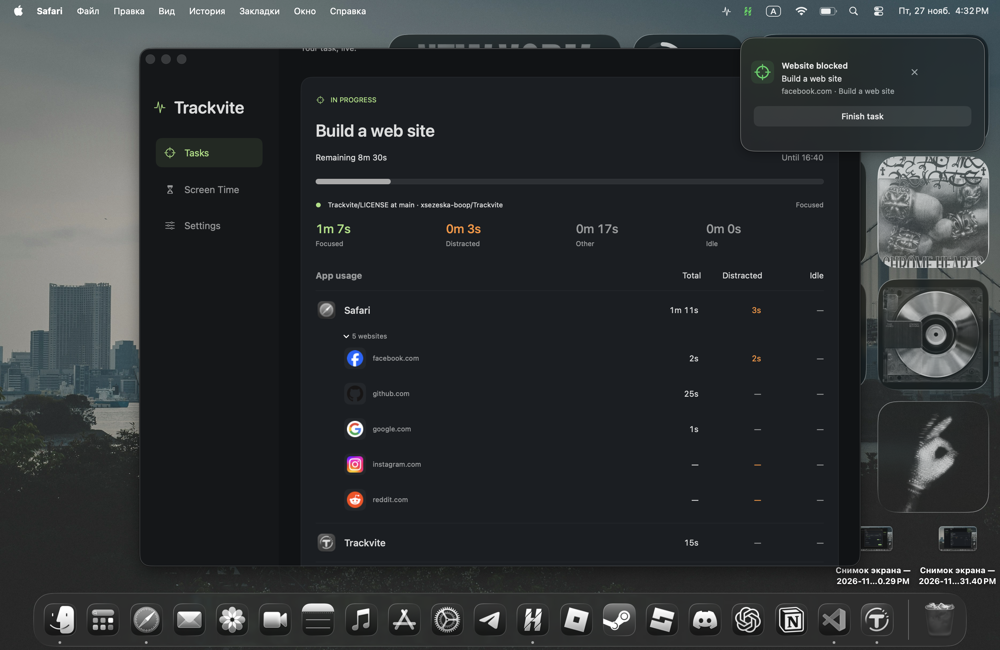
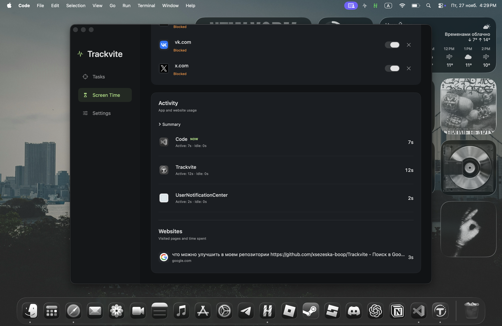
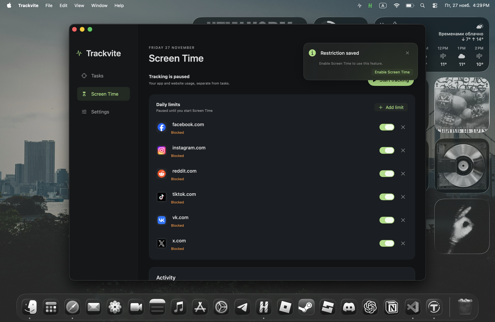

<p align="center">
  
</p>

# Trackvite · Beta 1.1

A native macOS app for focused work, task statistics and screen time. Create a task, choose your work apps, limit distractions and see where your time goes.

**macOS 14 or later · SwiftUI · English interface · Beta**

<p align="center">
  <a href="docs/screenshots/tasks.png">
    
  </a>
  <br>
  <sub>Focus on a task and see where your time goes.</sub>
</p>

<table>
  <tr>
    <td width="50%" align="center">
      <a href="docs/screenshots/screen-time.png"></a>
      <br><strong>Screen Time</strong><br>
      <sub>App and website usage in one place.</sub>
    </td>
    <td width="50%" align="center">
      <a href="docs/screenshots/restrictions.png"></a>
      <br><strong>Distraction limits</strong><br>
      <sub>Block distractions with clear in-app guidance.</sub>
    </td>
  </tr>
</table>

## Changes in Beta 1.1

- Immediate app and website blocking without a one-minute allowance.
- Automatic browser discovery, capability-based adapters and Built-in browser labels for embedded browsers.
- Local JSON persistence for tasks, schedules, limits, preferences and usage statistics.
- Strict permission checks for all tracking and actual task activation, including scheduled and restored tasks.
- Actionable in-app notifications and a responsive Start tracking button that explains missing access.
- Regression checks for persistence, permissions, browser discovery, notifications and task-start paths.

## Features

- **Tasks:** custom durations, multiple work apps, attached files and folders, scheduled starts and daily repeats.
- **Live task statistics:** app icons, cumulative time, distractions and idle time, with website details inside browser rows.
- **Browsers:** automatically discovers installed HTTP/HTTPS browser handlers through macOS; no browser-selection list is required. Safari/Chrome scripting adapters and accessibility metadata are selected according to the browser’s capabilities.
- **Screen Time:** independent tracking of apps and active browser tabs. Repeated visits are grouped rather than added as duplicate apps.
- **Block now:** block selected apps and websites without a time allowance; remains blocked until disabled or removed while Screen Time is tracking.
- **Daily limits:** individual app and website allowances, with custom hours and minutes. Limits pause when Screen Time is off and reset at local midnight.
- **Optional screen text:** on-device recognition of visible text. The OCR feature is optional, but Screen Recording permission is required for all tracking by the app’s strict permission policy.
- **Simple controls:** finish a task, pause tracking, manage permissions and clear the icon cache. In-app confirmations cover task and restriction actions, screen text, tracking and cache clearing. Missing prerequisites show a dismissible hint with Open Settings or Enable Screen Time. Action buttons recheck permissions before enabling anything.

## Download Beta 1.1

[Download Trackvite Beta 1.1 for Apple Silicon](https://github.com/xsezeska-boop/Trackvite/releases/download/v1.1.0-beta.1/Trackvite-Beta-1.1-macOS-arm64.zip) · [Release notes](https://github.com/xsezeska-boop/Trackvite/releases/tag/v1.1.0-beta.1)

Requires macOS 14 or later on Apple Silicon (M-series). This download is **not an Intel/universal build**. Unzip it and move `Trackvite.app` to Applications before granting macOS permissions. See the included `INSTALL.txt` and checksum file.

**Early testing build:** ad-hoc signed, without Developer ID or Apple notarization. macOS may block launch under its default security settings. The source is available for inspection and local building; a notarized public distribution is still pending.

## Build and run

Install Xcode Command Line Tools or Xcode, then run these commands from the project folder:

```sh
bash scripts/build.sh
open dist/Trackvite.app
```

The app is built locally; generated bundles and build caches are excluded from Git. The repository includes the macOS icon. To regenerate its sizes from the PNG:

```sh
bash scripts/build-icon.sh
```

### Signing and permissions

This beta does not include a Developer ID certificate or a notarized public release. Local builds use an available Apple Development or Developer ID Application signing identity, or ad-hoc signing when none is installed. You can select an identity explicitly:

```sh
TRACKVITE_SIGNING_IDENTITY="your signing identity" bash scripts/build.sh
```

Ad-hoc signing changes the app's permission identity when the signed contents change. macOS can then show an enabled permission for an older build while denying the current one. To avoid silently breaking existing grants, the build script refuses to replace a changed ad-hoc installation by default. An intentional replacement requires:

```sh
TRACKVITE_REPLACE_ADHOC=1 bash scripts/build.sh
```

After replacement, permissions may need to be granted again. If macOS retains an outdated entry, remove that Trackvite entry in System Settings and add the current `dist/Trackvite.app`. The app's Settings includes **Show app**, **Check again** and **Restart Trackvite**. The bundle identifier is `local.trackvite.prototype`.

## Getting started

1. Open **Settings**. Allow Accessibility, Screen Recording and Automation for at least one supported browser. All three access categories are required before any Screen Time or task statistics can be collected. Start tracking stays clickable to explain missing access; its action never starts collection without permission. Switching to an unapproved scriptable browser also pauses collection. Screen text recognition itself remains optional.
2. Open **Tasks**, create a named task, choose its work apps, duration and distractions, then start or schedule it.
3. View live app totals below the current task. Use **Finish task** to end it early.
4. Open **Screen Time** and choose **Start tracking** for general activity. This is independent of task tracking.
5. Use **Add limit** to set an app or website allowance. Click a limit's name to edit it, or turn it off at any time.

## Privacy and network access

- Tasks, schedules, usage statistics, restrictions, daily counters and preferences are saved locally in `~/Library/Application Support/Trackvite/state.json`. No backend or database is used. One versioned JSON snapshot is overwritten atomically, limited to 12 MiB, with owner-only file permissions. It is not encrypted by Trackvite.
- Changes are coalesced for about 30 seconds and flushed on normal exit or sleep. A forced kill or crash can lose the last unsaved interval. Unreadable, oversized or unsupported saved files are left unchanged rather than silently overwritten.
- App/site time is never credited for the period while Trackvite is closed. Active schedules use their original wall-clock dates; daily budgets reset at local midnight. The previous Screen Time and optional screen-text settings are restored on launch. Icon caches and OCR text are not persisted.
- Trackvite does not save screenshots, video or audio. Local activity summaries can contain app/window titles and visited page paths; URL queries and fragments are removed. Optional OCR runs on-device; ordinary tracking reads app activation and browser metadata.
- The app does not record keystroke contents or upload activity to an analytics backend. There are no accounts, cloud sync or subscriptions in this beta.
- App icons are read from installed applications. Website icons are first looked up in Safari's local favicon cache when accessible.
- Missing website icons trigger HTTPS requests to the website and its advertised icon URLs. This can include the site's home page to locate an icon, redirects and externally hosted icons. Those hosts receive normal network request information, including your IP address. Requests use an ephemeral session without persistent cookies, credentials or disk caching. The app is therefore **not entirely offline**.
- **Clear cache** clears cached icons and failed icon lookups. It does not delete tasks or usage statistics; visible icons may be fetched again.

Denied or revoked required access disables tracking, browser monitoring, OCR and task activity accounting, and prevents tasks from entering the active state. Previously saved statistics remain visible. When access is restored, Screen Time must be started again; tasks still within their scheduled window can resume accounting without counting the blocked interval.

## Known beta limitations

- Website restrictions are reactive: a blocked page can load before the active tab is detected and closed. Only the verified blocked active tab is closed; the browser itself remains available.
- Tab closing supports Safari and compatible Chrome-style scripting dictionaries through Automation. Newly discovered browsers without compatible scripting use accessibility metadata for tracking; tab closing is unavailable unless their scripting dictionary supports it. Detection does not guarantee a browser exposes tab addresses. macOS consent remains required.
- Restricted apps are covered by a focus/limit screen; they are not quit or hidden. This is a voluntary focus tool, not a tamper-proof parental control or network filter.
- General activity and task statistics are separate. Daily budgets count active time tracked during this launch, including tracked time before a limit was added. Idle time is excluded from budgets.
- Counters and histories are bounded. App/site budget counters are limited to 512 each, daily rules to 64, tasks to 100, and detailed task app/site statistics have their own caps.
- macOS permissions and signing still require care during development. Stable signing and notarization are needed before a polished direct-download release.

## Checks

Standalone assertion-based Swift checks are in `Tests/`. For example, to check daily budgets:

```sh
swiftc Sources/Tracker/ScreenTimeBudget.swift Tests/ScreenTimeBudgetChecks.swift -o /tmp/trackvite-budget-checks
/tmp/trackvite-budget-checks
```

`LocalStateChecks.swift` tests saved-data round trips, real tracker restoration, offline time handling, private permissions, damaged files and size limits using a temporary directory. `BrowserRegistryChecks.swift` tests discovery and capability selection without launching browsers.

Other checks cover task classification, cumulative statistics, schedules, subdomain matching, idle handling, bounded data and safe tab-closing scripts. Script checks do not close real user tabs. `NetworkSiteIconChecks.swift` makes real network requests.

## Feedback

When reporting a problem, include your macOS version, browser, steps to reproduce and expected behavior. For permission issues, specify which Settings row is affected. Redact private window titles, website addresses and screen contents before posting screenshots or logs.

## License and contributions

Trackvite is **source-available for noncommercial use** under the [PolyForm Noncommercial License 1.0.0](LICENSE), SPDX `PolyForm-Noncommercial-1.0.0`. Noncommercial use, modification and redistribution are permitted under its terms. Commercial use is not granted. Keep the license and [required notices](NOTICE) with redistributed copies. This is not an OSI-approved open-source license.

Want to help? See [CONTRIBUTING.md](CONTRIBUTING.md), open an issue or submit a pull request. You do not need write access to the main repository to propose changes.
